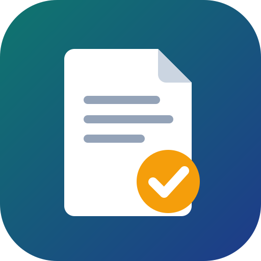
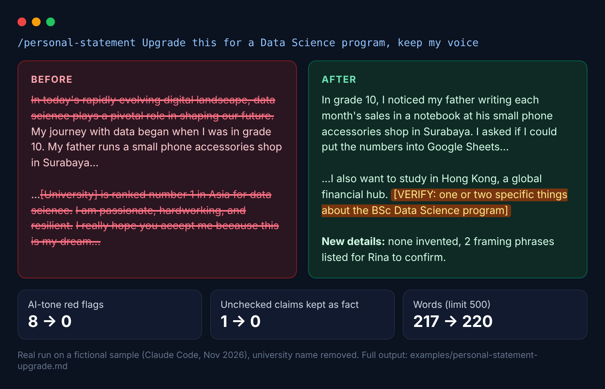

<p align="center">
  
</p>

<h1 align="center">Vetame21 Writing Skills</h1>

<p align="center">
  <b>Personal statements, CVs, reports and theses that sound like <i>you</i>, with nothing made up.</b><br>
  <a href="https://github.com/Vetame21/personal-statement-skill/stargazers"></a>
  <a href="LICENSE"></a>
  <a href="https://github.com/Vetame21/personal-statement-skill/releases"></a>
  <a href="https://github.com/Vetame21/personal-statement-skill/actions/workflows/ci.yml"></a>
</p>

<p align="center">
  
</p>

You have a real story, but the draft sounds like everyone else's, or like a chatbot wrote it. These skills turn your own material into a statement, CV or report a reader trusts. They keep your voice, cut the AI-sounding filler, and **never invent facts**: anything unconfirmed becomes a `[VERIFY]` note instead of a made-up claim.

Made for school leavers, scholarship and university applicants, and students writing reports and theses, in English or Indonesian. Works in ChatGPT, Claude, Gemini, DeepSeek, Kimi, Grok and Qwen, free or paid, and in coding agents such as Claude Code and Codex.

## ✨ What it does

- 📝 **personal-statement**: write, upgrade and stress-test personal statements, statements of purpose, motivation letters, scholarship essays and short answers. Keeps your story and voice, and preps you for the interview.
- 📄 **harvard-cv**: create, upgrade or tailor a one-page Harvard-style CV with action-verb, result-focused bullets.
- 🗣️ **humanizer**: make any text sound natural and like its author, and explain what an AI-detector report actually means.
- 🔬 **report**: lab, programming-lab, technical, makalah, internship (KP / magang) and progress reports.
- 🎓 **thesis**: coach a skripsi, tugas akhir or undergraduate thesis, from topic and Bab I-V or IMRaD chapters to citations and sidang (defense) prep.
- ⚖️ **debate-mode**: the AI researches before it agrees and gives a sourced verdict (Yes / No / Partly / Not enough evidence) instead of telling you what you want to hear.

**Built in:**
- 🔎 **Fact trace.** After every rewrite it lists any name, number, topic or scope word that wasn't in your text, then removes it or marks it `[VERIFY]`.
- 🧑‍⚖️ **Debate panels.** An admissions reader, a skeptic, your advocate and a tone detector argue over your draft before a moderator decides (examiner and supervisor for theses).
- 📚 **Research with sources.** What readers weigh (NACAC admission factors, UCAS's 2026 three-question format), what examiners reward, and how detectors work. Each fact has a link and a check date.
- ✅ **Checker scripts** for word limits, AI-tone phrases, placeholders, citations versus the reference list, and CV bullets. They run in coding agents, and the tests run in CI on Windows, macOS and Linux.

## 🛡️ What it won't do

- **Invent experiences, numbers, rankings or sources.** Gaps become `[VERIFY]` or `[ADD DETAIL]` for you to fill.
- **Help pass off AI writing as your own, or beat AI detectors.** No added typos, odd synonyms or "bypass" tricks. For graded work it checks what your course allows first, and coaches your own draft.
- **Promise an admission or a detector score.** It makes the writing clearer and more specific; readers decide.

## 📦 Install

**Option A: any chat AI, no install (free or paid)**

Download **[`download/vetame-writing-chat.md`](download/vetame-writing-chat.md)** (or the [`.txt`](download/vetame-writing-chat.txt) if an app refuses `.md`). It holds the personal statement, humanizer and Harvard CV skills in one file. Attach it at the start of a chat, or paste all of it, then say what you need.

| App | Free plan | Paid plan |
|---|---|---|
| ChatGPT | attach the file (Free allows 3 uploads a day) or paste it; a Project keeps it for every chat | put the file in a Project |
| Claude | upload [`download/vetame-writing.zip`](download/vetame-writing.zip) (all six skills) as a skill in Settings; reported available on free accounts since February 2026 | same, or add the chat file to a Project |
| Gemini | Settings → Skills → Upload skill → **folder**: unzip [`download/vetame-writing-lite.zip`](download/vetame-writing-lite.zip) and choose the folder (the full bundle failed to save in our test); no Skills yet? attach the chat file | same |
| DeepSeek, Kimi, Qwen | attach the chat file at the start of each new chat, or paste it | same |
| Grok | attach or paste | a Project with the file (reported for SuperGrok) |

Chat apps can't run the checker scripts, so the AI does those checks by reading and says so. Tested in the Gemini app; the others are untested so far, so please [tell us](https://github.com/Vetame21/personal-statement-skill/issues/new?template=feedback.yml) how it goes. Plans change often (checked November 2026): [OpenAI: uploads](https://help.openai.com/articles/8555545), [ChatGPT Projects limits (third party)](https://elephas.app/resources/chatgpt-projects-limits-files-size-and-how-many-projects), [TechRadar: Claude free plan](https://techradar.com/ai-platforms-assistants/claude/claude-just-made-its-most-powerful-tools-free-from-file-creation-to-app-integration-all-without-ads), [Claude Help: skills](https://support.claude.com/en/articles/12512180-using-skills-on-claude-ai), [Gemini Apps Help: skills](https://support.google.com/gemini/answer/17094296?hl=en&co=GENIE.Platform%3DDesktop), [Grok Free vs SuperGrok (third party)](https://freeacademy.ai/blog/grok-free-vs-supergrok-2026), [Kimi vs DeepSeek (third party)](https://toolquestor.com/vs/kimi-vs-deepseek).

**Option B: coding agents (Claude Code, Codex, Gemini CLI, Qwen Code, Kimi Code, OpenCode, DeepSeek-TUI)**

```bash
git clone https://github.com/Vetame21/personal-statement-skill
```

```bash
python3 personal-statement-skill/scripts/install.py
```

On Windows use `py` instead of `python3`. Python 3.9+, no extra packages. By default it installs all six skills for Claude Code (`~/.claude/skills`), the shared `~/.agents/skills` (Codex, Gemini CLI, Kimi Code, OpenCode, DeepSeek-TUI) and Qwen Code (`~/.qwen/skills`).
- `--tools codex` installs for one tool only.
- `--project .` installs into the current project instead.
- `--link` keeps the skills in sync with `git pull`.
- `--list` shows every folder; `--uninstall` removes them.

It never overwrites a same-named skill it didn't install. Restart your agent afterwards.

<details>
<summary>Where each tool reads skills from</summary>

| Tool | Reads skills from (user level) |
|---|---|
| Claude Code | `~/.claude/skills` (or the plugin marketplace below) |
| Codex CLI | `~/.agents/skills` (Codex also reads `~/.codex/skills`) |
| Gemini CLI | `~/.gemini/skills` or `~/.agents/skills` |
| Qwen Code | `~/.qwen/skills` |
| Kimi Code CLI | `~/.kimi-code/skills` or `~/.agents/skills` |
| OpenCode | `~/.config/opencode/skills`, `~/.claude/skills` or `~/.agents/skills` |
| DeepSeek, Qwen, Kimi and other **models** | Use them through one of the tools above; skills belong to the tool, not the model |

Paths checked against each tool's documentation in November 2026. OpenCode reads both `~/.claude/skills` and `~/.agents/skills`, so install to only one (for example `--tools codex`).
</details>

**Option C: Claude Code plugin marketplace**

```bash
claude plugin marketplace add Vetame21/personal-statement-skill
```

Then install the skills you want:

<!-- SKILLS_TABLE_START -->

| Skill | Install |
|---|---|
| [debate-mode](skills/debate-mode) | `claude plugin install debate-mode@Vetame21-skills` |
| [harvard-cv](skills/harvard-cv) | `claude plugin install harvard-cv@Vetame21-skills` |
| [humanizer](skills/humanizer) | `claude plugin install humanizer@Vetame21-skills` |
| [personal-statement](skills/personal-statement) | `claude plugin install personal-statement@Vetame21-skills` |
| [report](skills/report) | `claude plugin install report@Vetame21-skills` |
| [thesis](skills/thesis) | `claude plugin install thesis@Vetame21-skills` |

<!-- SKILLS_TABLE_END -->

## 🔄 Stay up to date

- **Chat apps:** download the file or ZIP again from [`download/`](download/). It's rebuilt with every release.
- **Installer:** pull the latest version, then install again. Your own edits in the installed copies are replaced, so keep them in a fork.

  ```bash
  cd personal-statement-skill && git pull && python3 scripts/install.py
  ```

- **Claude Code plugins:**

  ```bash
  claude plugin marketplace update Vetame21-skills
  ```

  ```bash
  claude plugin update personal-statement@Vetame21-skills
  ```

See what changed in [CHANGELOG.md](CHANGELOG.md).

## 🚀 Usage

Describe the task and the AI picks the skill, or call it by name:

| You type | What you get |
|---|---|
| `/personal-statement Upgrade this for CityU Data Science, keep my voice: …` | A light rewrite, a change table, the fact trace and a "check before submitting" list |
| `/personal-statement` + your notes, no draft | A new statement built from your material, debated before and after drafting |
| `/humanizer [text]` | It asks "humanize only, or upgrade too?", then rewrites at the lightest touch |
| `/harvard-cv Upgrade my CV for a data analyst internship: …` | An audit table, a one-page Harvard CV and before/after bullets |
| `/report` or `/thesis` + your draft or brief | Structure, section-by-section coaching, and citation and language checks |
| `/debate-mode Should I mention this news in my statement?` | A sourced verdict before any advice |

In Codex use `$personal-statement` instead of `/personal-statement`. In chat apps, just describe what you need after attaching the file. Skills that check current facts (debate-mode, news in a statement) need web search turned on.

## 👀 Example

```
You:    /personal-statement Upgrade this for CityU BSc Data Science, keep my voice
        "In today's rapidly evolving digital landscape, data science plays a pivotal
         role... CityU is ranked number 1 in Asia for data science..."

Skill:  Mode: Upgrade. Keeping your shop story and voice.

        In grade 10, I noticed my father writing each month's sales in a notebook
        at his small phone accessories shop in Surabaya...
        I also want to study in Hong Kong, a global financial hub. [VERIFY: replace
        the ranking claim with one or two specific things about CityU's BSc Data
        Science, checked on CityU's website]

        New details: "with statistics and code" is a goal, not something you did:
        confirm it's how you'd say it. No new names, numbers or achievements.
        Check: AI-tone red flags 8 -> 0. Words 220 / 500.
```

See the full run, with the map, keep list, change table and checker output, in [`examples/personal-statement-upgrade.md`](examples/personal-statement-upgrade.md). The sample is fictional.

## ❓ FAQ

**Will it write my essay for me?** It drafts from *your* material when the application allows AI help, and coaches your own draft when it doesn't. It asks about the AI-use rules first. You still need to be able to explain every sentence in an interview.

**Will it get my text past Turnitin or GPTZero?** No, and it won't try. Detectors make mistakes, especially on non-native English writers, and evasion tricks make writing worse. The humanizer explains what a detector flag means and makes your writing more specific. For background (Turnitin's 300-word minimum, scores under 20% shown as `*`, false-positive rates), see [`ai-detection.md`](shared/references/ai-detection.md).

**Does it make things up?** It's built not to: unconfirmed facts become `[VERIFY]`, and the fact trace lists anything new after a rewrite. Models can still slip, so read the "New details" list and the "check before submitting" list.

**Is my text sent anywhere?** The skills are plain instructions and local scripts, with no tracking. Your text goes only to the AI you choose to use, under that app's own privacy terms.

**Is it free?** Yes, MIT licensed. Use it with any chat AI, including free plans.

**English only?** English and Indonesian are fully supported (word lists, checkers, thesis Bab I-V). It talks to you in your language and writes in the language the application needs.

## 💬 Feedback

Your feedback decides what gets improved next.
- [Feedback form](https://github.com/Vetame21/personal-statement-skill/issues/new?template=feedback.yml): how it worked, in which app, and what was off. Please don't paste your real statement there, since issues are public.
- Found a bug? [Report it](https://github.com/Vetame21/personal-statement-skill/issues/new?template=bug_report.yml).
- Have an idea, or a university or scholarship you want covered? [Suggest it](https://github.com/Vetame21/personal-statement-skill/issues/new?template=feature_request.yml).

**Want to test it properly?** Follow [`testing/TESTER_BRIEF.md`](testing/TESTER_BRIEF.md) (coding agents: about 25 minutes, ends with a PDF report) or [`testing/GEMINI_CHAT_TEST.md`](testing/GEMINI_CHAT_TEST.md) (chat apps: about 15 minutes).

## 🧩 Works great together

Draft with **personal-statement**, polish the wording with **humanizer**, and use **debate-mode** before adding anything risky, such as news, rankings or a second program. Keep facts consistent across documents: **harvard-cv** checks that your CV and statement agree.

## 🤝 Contributing

Ideas, new regional guides and translations are welcome. Open an issue or a PR. Read [AGENTS.md](AGENTS.md) first; it applies to people and AI agents alike.

```
shared/references/   integrity, anti-AI tone (EN + ID), verify-and-cite, evidence standards,
                     debate rules, AI detection, authorship evidence   <- edit here
shared/scripts/      cite_check.py, text_check.py, writing_rules.py (shared rules)
skills/<name>/       SKILL.md, references/, scripts/ (references/shared/ is generated)
download/            chat file and skill ZIPs (generated)
plugins/             Claude Code plugin packages (generated)
scripts/             build.py, install.py, make_bundle.py
testing/             tester briefs, fictional samples, make_pdf.py
tests/               tests for every script, the build and the bundles
```

After a change, run these in order (Python 3.9+, `pip install pyyaml` for the build):

```bash
python scripts/build.py
```

```bash
python -m unittest discover -s tests -v
```

```bash
python scripts/build.py --check
```

CI runs the tests and `build.py --check` on Python 3.9, 3.11, 3.12 and 3.13 (Linux) and 3.12 (Windows and macOS). For a release, bump `VERSION`, add a `CHANGELOG.md` entry, push, then push a tag such as `v2.3.0`. The Release workflow publishes it with the `download/` files attached.

If this helped you, please ⭐ the repo so more students can find it.

## Credits

The idea of a structured, stage-based personal statement skill comes from [DiamondhunterSA/personal-statement-skill](https://github.com/DiamondhunterSA/personal-statement-skill) (MIT). This collection is a full rewrite with new structure, content, research and tools; see [CREDITS.md](CREDITS.md).

## License

[MIT](LICENSE). Not affiliated with Harvard, Turnitin, UCAS, NACAC, CityU or any other university, company or app named here.
